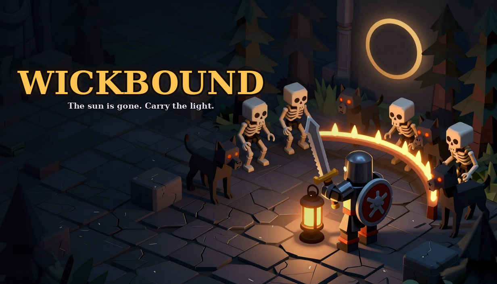

  

<h3 align="center">The sun is gone. Carry the light.</h3>

The sun went out eleven years ago. Towns survive around their lanterns, and the Dark is full of things.
**Wickbound** is a set of games about the people who carry light back into it.

## Wickbound ARPG

A real-time, isometric action RPG built in Godot. Your lantern lights the way. You fight with class skill
trees, a shared star constellation, socketed Embers and loot with affixes, and online co-op is on the way.

**In development.** Playtest builds are free:

- **Download:** [latest playtest build](https://github.com/Wickbound/wickbound-arpg-playtest/releases/latest)
- **Feedback and bugs:** [open an issue](https://github.com/Wickbound/wickbound-arpg-playtest/issues)

## Wickbound (turn-based)

The original turn-based party RPG: lead a party of Wardens into the Dark. Your lantern is a resource that
drains as you explore, and when it runs dry the enemy strikes first.
